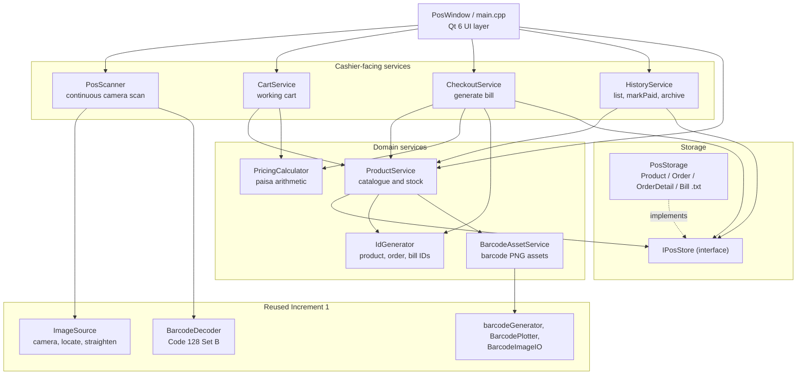
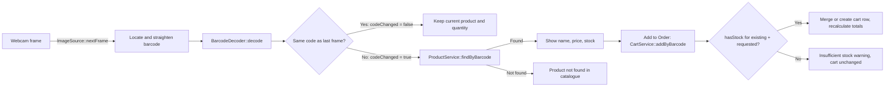
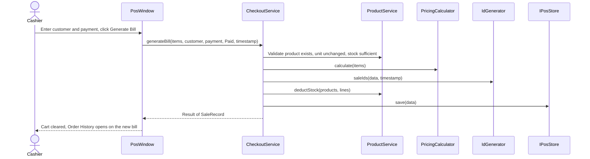
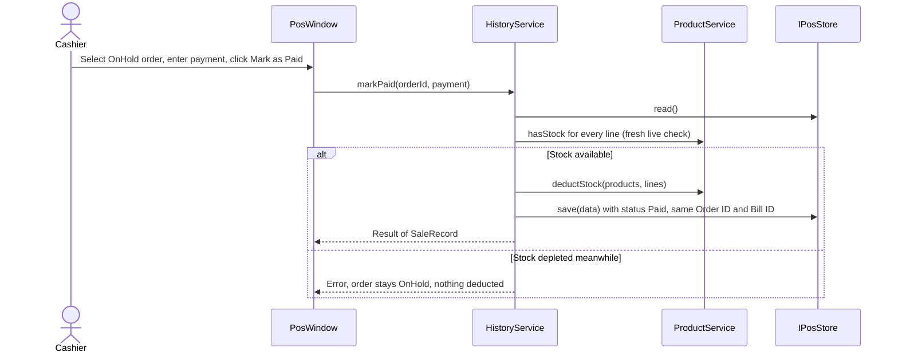

# Eyeris — Retail POS System

**Increment 2 of the Super Store Inventory and Sales Application (*Introduction to Software Engineering* course project)**

Eyeris is a standalone **C++17 desktop Point-of-Sale (POS) and inventory management system** powered by **Qt 6**, **OpenCV 4**, and custom, in-house **Code 128** barcode generation and continuous camera scanning.

Increment 1 built a barcode generator and reader. **Increment 2 embeds that engine into a complete, multi-page POS application:** a persistent product catalogue, live inventory tracking, camera-driven cart management, pricing / tax / discount calculation, bill generation, on-hold orders, and an order history archive.

The Code 128 encoder, checksum, and decoder are **written by the team from scratch**. No external barcode library (such as ZXing or OpenCV's `BarcodeDetector`) is used. Qt provides the graphical interface, and OpenCV provides image processing, computer-vision localization, and camera streaming.

---

## Table of Contents

1. [Features](#features)
2. [Requirements Covered](#requirements-covered)
3. [Tech Stack](#tech-stack)
4. [Building and Running](#building-and-running)
5. [Using the Application](#using-the-application)
6. [Architecture & System Flow](#architecture--system-flow)
7. [Data Storage & File Formats](#data-storage--file-formats)
8. [Repository Structure](#repository-structure)
9. [UML Diagrams & Module Reference](#uml-diagrams--module-reference)
10. [Error Handling](#error-handling)
11. [Design Decisions](#design-decisions)
12. [Team](#team)
13. [Documentation](#documentation)

---

## Features

### Point of Sale and Checkout (Current Order)

- **Continuous camera scanning:** the live webcam preview stays active. Items held in view are automatically detected, straightened, decoded, and matched against `Product.txt` with no manual trigger.
- **Duplicate suppression:** holding the same item in front of the camera across many frames keeps the product visible without re-adding it or resetting the entered quantity (`codeChanged == false`).
- **Dynamic cart management:** add fractional quantities (kg) or integer counts, adjust rows with inline `+` / `-` controls, and remove a row by reducing its quantity to `0`. Adding a product that is already in the cart merges into the existing row.
- **Strict live stock checks:** the app verifies `(already in cart + requested) <= available stock` against live storage and shows clear inline feedback on a deficit.
- **Captured pricing integrity:** each cart row snapshots the unit price, tax, and discount at the moment it is added. Later catalogue edits do not change the price of an item already in the cart.
- **Unit mismatch protection:** if a product's measurement unit (`Count` vs `Weight`) is changed in the catalogue while it is in the cart, positive quantity changes and billing are blocked until the problem is resolved.

### Pricing and Tax Calculation

- **Exact paisa arithmetic:** every monetary amount is a 64-bit integer number of paisas (`100 paisa = PKR 1.00`). There is no floating-point money.
- **Half-paisa rounds up:** a rate is multiplied by the quantity (stored in thousandths), divided by 1000, and rounded with `(rate * qty + 500) / 1000`.
- **Transparent summary:** the cart shows product count, total units / kg, Subtotal (before tax and discount), Total Tax (calculated on the full quantity, before discount), Total Discount, and the final Payable amount in PKR.

### Transaction Handling and Multi-File Persistence

- **Two billing actions:**
  - **Generate Bill (Paid):** validates payment (`Cash`, `Card`, or `Wallet`), deducts live stock in `Product.txt`, assigns an 8-digit Order ID and a 9-digit Bill ID, and saves the records across `Order.txt`, `OrderDetail.txt`, and `Bill.txt` with status `Paid`.
  - **Generate Bill and Put on Hold (Unpaid):** saves the complete bill with status `OnHold`. Stock is **not** deducted or reserved, and no payment is recorded.
- **Delimiter contract:** each record ends with `#`. String fields (IDs, barcodes, names, dates, contacts, merchants) are wrapped in double quotes using `std::quoted`, so whitespace is preserved.

### Order History, Deferred Payment, and Archive

- **Historical bill inspector:** lists past non-archived orders. Selecting one shows the exact bill as it was saved, with historical prices, discounts, quantities, totals, and payment status.
- **Deferred payment (Mark as Paid):** for an `OnHold` order, enter the payment details and complete the sale. The app performs a **fresh live stock check**, deducts inventory, and updates the status to `Paid` in `Order.txt` and `Bill.txt` while **preserving the original Order ID and Bill ID**.
- **Archive:** hides an order from the active list while all transaction records stay on disk.

### Product Catalogue Management

- **Catalogue browser:** a list of all products. Items with zero stock stay visible with an **Out of stock** badge.
- **Full specifications and barcode preview:** the inspector shows product ID, barcode, acronym, name, unit, unit price, tax, discount, stock, and the generated barcode PNG with its file path.
- **Restock and edit:** restock by updating the quantity, and change prices and details. The barcode number is fixed after creation.
- **Referential integrity locks:** deleting a product, or changing its measurement unit, is blocked while any active `OnHold` order references it.
- **New product creation:** the form validates a unique 6-digit Code 128 barcode, saves its PNG to `assets/`, allocates the next Product ID, and appends the record to `Product.txt`.

### Reused Increment 1 Capabilities

- Standalone 6-digit Code 128 barcode generator that saves a PNG.
- Barcode reader for uploaded PNG / JPEG images.
- Single-shot webcam barcode scan.

---

## Requirements Covered

| Requirement | Where it is implemented | Primary actor |
|---|---|---|
| Generate a 6-digit Code 128 Set B barcode (first digit non-zero, `100000`–`999999`) | `barcodeGenerator.cpp`, `BarcodePlotter.cpp` | Manager, Cashier |
| Display the barcode on screen and save it as a PNG image | `BarcodePlotter.cpp`, `BarcodeImageIO.cpp` | Manager, Cashier |
| Read a 6-digit barcode and display the number | `BarcodeDecoder.cpp` | Cashier, Manager |
| Read from an uploaded image or the webcam | `camera-harness.cpp` (`ImageSource`) | Cashier, Manager |
| Team-written encoder / decoder, no non-standard barcode libraries | `barcodeGenerator.cpp`, `BarcodeDecoder.cpp` | Architecture |
| Continuous camera-based barcode reader in the POS | `PosScanner.cpp`, `camera-harness.cpp` | Cashier |
| The entire POS application is GUI-based (Qt 6) | `PosWindow` (Qt 6 Widgets / Svg) | Cashier, Manager |
| Display product specifications from `Product.txt` on barcode scan | `PosScanner.cpp`, `ProductService.cpp` | Cashier |
| Manage `Product.txt` with space-separated fields, quoted strings, and a `#` end-of-line marker | `PosStorage.cpp`, `ProductService.cpp` | Manager, Storage |
| Record the order and generate a bill with live inventory validation | `CartService.cpp`, `CheckoutService.cpp` | Cashier |
| View the product description on scan or via the inline Description button | `CurrentOrderPage`, `ProductService.cpp` | Cashier |
| Save orders to `Order.txt` (8-digit ID ending in the day, date, time, customer, status, payment) | `src/CheckoutService.cpp`, `PosStorage.cpp` | Cashier |
| Save purchased products to `OrderDetail.txt` (order ID, product ID, barcode, quantity) | `src/CheckoutService.cpp`, `PosStorage.cpp` | Cashier |
| Save the bill to `Bill.txt` (9-digit Bill ID, customer, order ID, item rates, totals, status) | `src/CheckoutService.cpp`, `PosStorage.cpp` | Cashier |
| On-hold orders, Mark as Paid with deferred stock deduction, Archive workflow, referential deletion lock | `CheckoutService.cpp`, `HistoryService.cpp`, `ProductService.cpp` | Cashier, Manager |

---

## Tech Stack

| Area | Technology / version | Role in the project |
|---|---|---|
| **Language** | C++17 | Language standard used across all modules |
| **GUI framework** | Qt 6 (`Widgets`, `Svg`) | Desktop UI, page navigation, SVG icons, window layouts |
| **Computer vision** | OpenCV 4 (`core`, `imgproc`, `imgcodecs`, `videoio`) | Webcam capture, thresholding, perspective warp, barcode rendering |
| **Build system** | CMake 3.16 or newer | Cross-platform build management |
| **Compilers** | MSVC 2022 (v143+), Apple Clang 14+, GCC 10+ | Supported toolchains |

---

## Building and Running

### Prerequisites

- A C++17 compiler (MSVC 2022, Apple Clang 14+, or GCC 10+)
- **CMake** 3.16 or newer
- **Qt 6** with the `Widgets` and `Svg` modules
- **OpenCV 4** with the CMake config files installed
- A webcam, for camera scanning

### Windows (Visual Studio 2022 + MSVC)

Adjust the paths to match your machine.

```powershell
# 1. Configure CMake with the Qt 6 and OpenCV 4 paths:
cmake -S . -B build -G "Visual Studio 17 2022" -A x64 `
  -DCMAKE_PREFIX_PATH="D:/Qt/6.11.0/msvc2022_64" `
  -DOpenCV_DIR="D:/opencv/build"

# 2. Compile in Release mode:
cmake --build build --config Release --parallel 4

# 3. Deploy the Qt runtime DLLs and plugins (first time only):
& "D:\Qt\6.11.0\msvc2022_64\bin\windeployqt.exe" --release "build\Release\Eyeris.exe"

# 4. Copy the OpenCV DLL (if it is not already on your PATH):
Copy-Item "D:\opencv\build\x64\vc16\bin\opencv_world4140.dll" "build\Release\" -Force

# 5. Launch Eyeris:
.\build\Release\Eyeris.exe
```

### macOS (Clang + Homebrew)

```sh
# 1. Configure:
cmake -S . -B build/eyeris-ui \
  -DCMAKE_PREFIX_PATH="$HOME/Qt/6.11.0/macos" \
  -DOpenCV_DIR=/opt/homebrew/opt/opencv@4/lib/cmake/opencv4

# 2. Build:
cmake --build build/eyeris-ui --parallel 4

# 3. Run:
./build/eyeris-ui/Eyeris.app/Contents/MacOS/Eyeris
```

- `CMAKE_PREFIX_PATH` should point to your Qt 6 kit (the folder that contains `lib/cmake/Qt6`).
- `OpenCV_DIR` should point to the folder that contains `OpenCVConfig.cmake`.
- On macOS the build produces an app bundle, and the system asks for webcam permission the first time the camera starts.

### Linux and other setups

The same CMake project applies. Point `CMAKE_PREFIX_PATH` at your Qt 6 kit and `OpenCV_DIR` at the folder containing `OpenCVConfig.cmake`, then build and run the `Eyeris` executable from the build directory.

> **Run from the build output.** The `assets/` folder (UI icons and generated barcode PNGs) must be reachable by the executable, so launch the app from the build output rather than copying the binary elsewhere.

---

## Using the Application

The window has a persistent **navigation sidebar** on the far left and two working panels beside it:

```text
+------------------+--------------------------------------+------------------------------------+
| SIDEBAR          | CENTRE PANEL (Working List / Cart)   | RIGHT PANEL (Context / Inspector)  |
|                  |                                      |                                    |
| [1] Place Order  | Current Order items, inline qty (+/-)| Live Camera Feed, Scanned Product  |
|     (Current)    | Customer Name, Totals & Bill buttons | Stock, Description, Qty, Add to Cart|
|                  |                                      |                                    |
| [2] Order History| Scrollable list of past non-archived | Complete saved bill inspector,     |
|     (Past Orders)| orders (Order#, Date, Customer, PKR) | Payment inputs, Mark as Paid, Archive|
|                  |                                      |                                    |
| [3] Product      | Tabs: [View Catalogue] [Add Product] | Selected Product Specs & Barcode   |
|     Catalogue    | Product list, prices, stock status   | Edit/Restock form, Delete Product  |
+------------------+--------------------------------------+------------------------------------+
```

There are two roles. The **Cashier** operates the register (Current Order and Order History). The **Store Manager** inherits everything the Cashier can do and is also responsible for the **Product Catalogue**.

### Page 1: Current Order (Place Order)

[](documentation/Increment%202/Diagrams/Eyeris-1%28curr-ord%29.jpeg)

1. **Scan.** The camera starts automatically when you open the page. Hold a product's barcode in front of it. The right panel shows the product name, price excluding tax, and available stock. Removing the barcode from view leaves the product information on screen.
2. **Description (optional).** Click **Description** to expand further product details inline, below the quantity input. No popup opens.
3. **Add to Order.** Enter a quantity (units for `Count`, kg for `Weight`) and click **Add to Order**. If the product is already in the cart, the quantity is merged into its existing row. If the stock is insufficient, an inline warning appears and your input is kept so you can correct it.
4. **Manage the cart.** Each row shows the acronym, unit price (excl. tax), unit discount, quantity, and line amount. Use `+` / `-` to adjust, and a row at `0` is removed. The summary box shows the live totals.
5. **Bill.**
   - **Generate Bill (Paid):** enter the Customer Name (required), an optional Contact, the Payment Amount (must equal the payable total), the Payment Mode (`Cash`, `Card`, `Wallet`), and the Merchant, then click **Generate Bill**. The cart clears and **Order History** opens with the new order selected.
   - **Generate Bill and Put on Hold:** enter the Customer Name and click **Generate Bill and Put on Hold**. The order is saved as `OnHold` with no stock deducted, the cart clears, and **Order History** opens on the held order.

### Page 2: Order History (Past Orders)

[](documentation/Increment%202/Diagrams/Eyeris-2%28past-ord%29.jpeg)

1. **Inspect.** The centre list shows every non-archived order (Order ID, customer, date / time, payable amount, status `Paid` or `OnHold`). Click one to see its saved bill in the right panel.
2. **Mark as Paid (held orders).** Select an `OnHold` order, enter the Payment Mode, Merchant, and Amount, and click **Mark as Paid**. A fresh live stock check runs first. If stock is available, it is deducted and the order becomes `Paid` under its original Order ID and Bill ID.
3. **Archive.** Click **Archive** to set the status to `Archived` and hide the order from the active list. Its records stay on disk.

### Page 3: Product Catalogue (Store Manager)

[](documentation/Increment%202/Diagrams/Eyeris-3%28prod-cat%29.jpeg)

**View Catalogue tab**

- Browse all products (acronym, name, price, stock). Zero-stock items show an **Out of stock** badge.
- Select a product to see its full specification and barcode image.
- **Edit and restock:** change the stock, price, tax, discount, and other details. The barcode number cannot be changed, and the measurement unit cannot be changed while an `OnHold` order references the product.
- **Delete Product:** blocked with an error if an `OnHold` order references the product.

**Add Product tab**

1. Fill in Name, Acronym (max 8 characters), Unit (`Count` or `Weight`), Unit Price (PKR), Tax per unit, Discount per unit, Initial Stock, and a unique 6-digit barcode (`100000`–`999999`, no leading zero).
2. Click **Generate Preview** to validate the barcode and see the Code 128 image.
3. Click **Save Product**. The app allocates the next Product ID, saves the barcode PNG into `assets/`, and writes the record to `Product.txt`.

### Increment 1 tools

The standalone barcode generator, uploaded-image reader, and single webcam scan from Increment 1 remain part of the application. Their original design notes are in `documentation/Increment 1/`.

**Tips for a good scan:** keep the whole barcode in view including the white margins on each side, use even lighting without glare, show only one barcode at a time, and hold it steady and large enough in the frame.

---

## Architecture & System Flow

The backend is split into small services that receive their dependencies by reference at construction (non-owning dependency injection). The Qt UI layer (`PosWindow`, `main.cpp`) sits on top and calls the services.



### Scan-to-cart flow



### Generate Bill (Paid)



### Mark a held order as paid



---

## Data Storage & File Formats

Eyeris keeps `Product.txt`, `Order.txt`, `OrderDetail.txt`, and `Bill.txt` in the checkout's `data/` folder. Product PNGs are under `data/barcodes/`. The path saved in `Product.txt` is relative to `data/`. Git ignores this runtime folder.

The four record files are UTF-8 plain text, one record per line. Fields are separated by spaces, and string fields are wrapped in double quotes with `std::quoted`. Records end with `#` (except `OrderDetail.txt`). Storage is hidden behind the `IPosStore` interface, so the file format can change without touching the services.

**Units:** money is stored in **paisas** (`45000` = PKR 450.00). Quantities and stock are stored in **thousandths** (`50000` = 50 items, `1500` = 1.5 kg).

### `Product.txt`

```text
"id" "barcode" "acronym" "name" unit unitPrice taxPerUnit discountPerUnit available "barcodeImagePath" #
```

Example:

```text
"100001" "123456" "TEA-BLK" "Black Tea 250g" count 450.00 76.50 0.00 50 "barcodes/123456.png" #
```

### `Order.txt`

```text
"orderId" "YYYY-MM-DD" "HH:mm:ss" "customerName" "customerContact" status paymentAmount paymentMode "merchant" #
```

Example (the 8-digit Order ID ends in the day of the month):

```text
"20261119" "2026-11-19" "14:32:00" "Ali Khan" "03001234567" paid 52650 cash "-" #
```

### `OrderDetail.txt`

No `#` terminator.

```text
"orderId" "productId" "barcode" quantity
```

Example:

```text
"20261119" "P001" "123456" 1000
```

### `Bill.txt`

```text
"billId" "customerName" "orderId" ["acronym" unitPrice discountPerUnit quantity]... subtotal tax discount payable status #
```

Each line item repeats four fields (`acronym`, `unitPrice`, `discountPerUnit`, `quantity`), followed by the four totals, the status, and `#`. Illustrative example with a 9-digit Bill ID:

```text
"300000001" "Ali Khan" "20261119" "TEA-BLK" 45000 0 1000 45000 7650 0 52650 paid #
```

### Status values

| Order status | Meaning |
|---|---|
| `InProgress` | Working state in the data model, before a bill is saved |
| `OnHold` | Bill saved, payment not recorded, stock not deducted |
| `Paid` | Payment recorded and stock deducted |
| `Archived` | Hidden from the active history list, records preserved |

---

## Repository Structure

```text
ISE-Project/
├── CMakeLists.txt                         # CMake build script
├── README.md                              # This file
├── .gitignore                             # Git ignore rules
├── ReaderContracts.h                      # Shared Increment 1 reader structs
├── PosTypes.h                             # Shared Increment 2 business structs and enums
├── IPosStore.h                            # Pure abstract storage interface
├── PosStorage.h / .cpp                    # File storage implementation (4 text files)
├── IdGenerator.h / .cpp                   # Product, order, and bill ID generation
├── ProductService.h / .cpp                # Product catalogue and stock validation service
├── BarcodeAssetService.h / .cpp           # Barcode generation and PNG asset helper
├── CartService.h / .cpp                   # Cart management and live stock verification
├── PricingCalculator.h / .cpp             # Rounding and payable calculation engine
├── PosScanner.h / .cpp                    # Continuous POS camera scanning adapter
├── camera-harness.h / .cpp                # ImageSource: OpenCV capture, locate, straighten
├── barcodeGenerator.h / .cpp              # Code 128 Set B encoder and checksum verification
├── BarcodePlotter.h / .cpp                # Barcode renderer and QImage conversion
├── BarcodeImageIO.h / .cpp                # PNG image saving helpers
├── BarcodeDecoder.h / .cpp                # Custom Code 128 Set B barcode decoder
├── main.cpp                               # Application entry point and POS window integration
├── src/                                   # Checkout and History subsystem
│   ├── CheckoutService.h / .cpp           # Bill generation, stock deduction, payment recording
│   └── HistoryService.h / .cpp            # Order history retrieval, deferred payment, archive
├── assets/                                # UI icons and generated barcode PNGs
│   ├── arrow-right.svg
│   ├── chevron-left.svg
│   └── eyeris-background.png
└── documentation/                         # Project design documents and diagrams
    ├── Decisions.md                       # Architecture and design decisions register
    ├── Increment 1/                       # Increment 1 documentation and diagrams
    │   ├── Increment 1 Requirements.md
    │   ├── Program Flow.md
    │   ├── increment1_meetingnotes.md
    │   ├── UML-diagram.png
    │   └── usecase_diagram.png
    └── Increment 2/                       # Increment 2 documentation and diagrams
        ├── Increment 2 Requirements.md
        ├── Increment2proposal.md
        ├── Interface Design.md
        ├── Proposed System Design.md
        ├── Meeting Notes.md
        ├── Increment2_UML_Class_Structure.md
        ├── Increment2_UseCase_Specification.md
        └── Diagrams/
            ├── UML-Backend.png            # Complete backend class diagram
            ├── UML-DataRecords.png        # Shared data structures diagram
            ├── use-case-diagram.png       # Complete POS use case diagram
            ├── Eyeris-1(curr-ord).jpeg    # UI screenshot: Current Order page
            ├── Eyeris-2(past-ord).jpeg    # UI screenshot: Order History page
            └── Eyeris-3(prod-cat).jpeg    # UI screenshot: Product Catalogue page
```

---

## UML Diagrams & Module Reference

Click any diagram to open it full size.

### Use Case Diagram

[](documentation/Increment%202/Diagrams/use-case-diagram.png)

### Backend Class Diagram

[](documentation/Increment%202/Diagrams/UML-Backend.png)

### Shared Data Records Diagram

[](documentation/Increment%202/Diagrams/UML-DataRecords.png)

The full class dictionary, relationship list, and PlantUML / Mermaid source are in [`Increment2_UML_Class_Structure.md`](documentation/Increment%202/Increment2_UML_Class_Structure.md). The user interface (`PosWindow`, `main.cpp`) is intentionally not part of the class diagrams.

### Module Reference

| Module | Files | Responsibility |
|---|---|---|
| **`IPosStore` / `PosStorage`** | `IPosStore.h`, `PosStorage.h/.cpp` | Abstract interface and file-backed persistence for `Product.txt`, `Order.txt`, `OrderDetail.txt`, and `Bill.txt`. |
| **`IdGenerator`** | `IdGenerator.h/.cpp` | Generates sequential 8-digit Order IDs, 9-digit Bill IDs, and product IDs. |
| **`ProductService`** | `ProductService.h/.cpp` | Product lookup, live inventory checks (`hasStock`), stock deduction (`deductStock`), and catalogue create / update / remove. |
| **`BarcodeAssetService`** | `BarcodeAssetService.h/.cpp` | Reuses the Increment 1 encoder and renderer to preview barcodes and save barcode PNG assets under `assets/`. |
| **`CartService`** | `CartService.h/.cpp` | Manages working cart items, validates stock before adding, checks unit consistency, and calculates row totals. |
| **`PricingCalculator`** | `PricingCalculator.h/.cpp` | Pure calculator for subtotal, tax, discount, and payable using integer paisa math with half-paisa rounding up. |
| **`PosScanner`** | `PosScanner.h/.cpp` | Continuous camera scanner adapter around `ImageSource` and `BarcodeDecoder`, filtering duplicate frame scans. |
| **`CheckoutService`** | `src/CheckoutService.h/.cpp` | Validates payments, deducts inventory, assigns IDs, and saves complete Paid or OnHold transactions. |
| **`HistoryService`** | `src/HistoryService.h/.cpp` | Lists non-archived orders, retrieves exact saved bills, completes payment via `markPaid`, and archives orders. |
| **`ImageSource`** | `camera-harness.h/.cpp` | Low-level camera stream grabber, gradient-tensor localization, and perspective warping. |
| **`BarcodeDecoder`** | `BarcodeDecoder.h/.cpp` | Strict Code 128 Set B decoder with Otsu binarization, 31-line sampling, and independent checksum verification. |
| **`barcodeGenerator`, `BarcodePlotter`, `BarcodeImageIO`** | `barcodeGenerator.*`, `BarcodePlotter.*`, `BarcodeImageIO.*` | Increment 1 utilities: validation and Code 128 Set B encoding with Mod-103 checksum, barcode rendering to `cv::Mat` / `QImage`, and PNG saving. |

---

## Error Handling

| Failure / scenario | System behavior |
|---|---|
| **Camera hardware failure** | `PosScanner::poll()` returns `success = false`, camera polling stops, and an inline error is shown in the UI. |
| **Insufficient inventory stock** | `CartService::addByBarcode()` blocks the addition and returns: *"Insufficient stock: X already in order + Y requested exceeds Z available."* |
| **Product measurement unit changed** | Positive quantity changes and checkout are blocked: *"Product measurement unit has changed. Restore the original unit or remove this item from the order."* |
| **Unregistered barcode scanned** | `success = true`, the preview continues, and *"Product not found in catalogue."* is shown. |
| **Same barcode held in frame** | `PosScanner::poll()` sets `codeChanged = false`; the preview continues without re-adding or clearing the quantity. |
| **Stock depleted at checkout** | Checkout aborts with an error. Cart items and inventory stay unchanged. |
| **Held order's stock depleted** | `HistoryService::markPaid()` re-checks live stock. If another sale used it up, payment is rejected and the order stays `OnHold`. |
| **Deleting a product in a held order** | `ProductService::remove()` is blocked: *"Cannot delete product referenced by an active on-hold order."* |
| **Negative or invalid quantities** | Rejected at the input validation boundary before they reach the domain services. |

---

## Design Decisions

| Decision | Outcome |
|---|---|
| Barcode symbology and libraries | **Code 128 Set B**, with the encoder, checksum, and decoder written by the team. No external barcode library is used. |
| Storage abstraction | Services depend on the **`IPosStore` interface**, implemented by `PosStorage`. The file format is isolated behind it. |
| Dependency injection | High-level services receive **non-owning references** to their dependencies at construction (`IPosStore&`, `ProductService&`, `PricingCalculator&`, `IdGenerator&`, `ImageSource&`, `BarcodeDecoder&`). |
| Pure data records | Structs in `PosTypes.h` (`Product`, `CartItem`, `SaleRecord`, `Totals`, and others) hold values only, with no behavior. |
| Reuse of Increment 1 | `PosScanner` adapts the camera harness and decoder to continuous scanning, and `BarcodeAssetService` adapts barcode plotting and saving. |
| Money and quantities | **Integer paisas and thousandths** everywhere. Half-paisa rounds up with `(rate * qty + 500) / 1000`. |
| Price snapshots | A cart row keeps the price, tax, and discount captured when it was added, so catalogue edits cannot change an item already scanned. |
| On-hold orders | Stock is **not** reserved or deducted when an order is put on hold. It is re-checked and deducted when the order is marked paid. |
| Order integrity | Mark as Paid keeps the original Order ID and Bill ID. Archiving hides an order but never deletes its records. |
| Referential locks | Deleting a product, or changing its unit, is blocked while an `OnHold` order references it. The barcode of an existing product is fixed. |
| UI separation | The Qt UI layer is kept out of the backend services and class diagrams. |

The full history is in [`documentation/Decisions.md`](documentation/Decisions.md) and [`documentation/Increment 2/Meeting Notes.md`](documentation/Increment%202/Meeting%20Notes.md).

---

## Team

| Member | Area of ownership | Assigned source files |
|---|---|---|
| **Zaryab** (P1) | Desktop GUI, page navigation, UI integration, and build setup | `main.cpp`, `CMakeLists.txt`, `assets/` |
| **Nosher** (P2) | Product catalogue service, inventory rules, and barcode asset generation | `ProductService.h/.cpp`, `BarcodeAssetService.h/.cpp` |
| **Khurram** (P3) | Data storage engine (4 files), storage interface, and ID sequencing | `IPosStore.h`, `PosStorage.h/.cpp`, `IdGenerator.h/.cpp` |
| **Rayyan** (P4) | Cart service, pricing and rounding calculations, and continuous POS camera scanning | `CartService.h/.cpp`, `PricingCalculator.h/.cpp`, `PosScanner.h/.cpp` |
| **Rayan Dar** (P5) | Bill checkout, stock deduction, order history, deferred payment, and archiving | `src/CheckoutService.h/.cpp`, `src/HistoryService.h/.cpp` |

---

## Documentation

### Diagrams

- [`documentation/Increment 2/Diagrams/use-case-diagram.png`](documentation/Increment%202/Diagrams/use-case-diagram.png): use case diagram
- [`documentation/Increment 2/Diagrams/UML-Backend.png`](documentation/Increment%202/Diagrams/UML-Backend.png): backend architecture class diagram
- [`documentation/Increment 2/Diagrams/UML-DataRecords.png`](documentation/Increment%202/Diagrams/UML-DataRecords.png): core data structures and DTOs diagram
- [`documentation/Increment 2/Diagrams/Eyeris-1(curr-ord).jpeg`](documentation/Increment%202/Diagrams/Eyeris-1%28curr-ord%29.jpeg): Eyeris UI, Current Order page
- [`documentation/Increment 2/Diagrams/Eyeris-2(past-ord).jpeg`](documentation/Increment%202/Diagrams/Eyeris-2%28past-ord%29.jpeg): Eyeris UI, Order History page
- [`documentation/Increment 2/Diagrams/Eyeris-3(prod-cat).jpeg`](documentation/Increment%202/Diagrams/Eyeris-3%28prod-cat%29.jpeg): Eyeris UI, Product Catalogue page

### Specifications and Records

- [`documentation/Increment 2/Increment2_UseCase_Specification.md`](documentation/Increment%202/Increment2_UseCase_Specification.md): full use case specifications and interaction flows
- [`documentation/Increment 2/Increment 2 Requirements.md`](documentation/Increment%202/Increment%202%20Requirements.md): official assignment requirements
- [`documentation/Decisions.md`](documentation/Decisions.md): project architecture and design decisions register
- [`documentation/Increment 1/`](documentation/Increment%201/): Increment 1 requirements, program flow, meeting notes, and diagrams

---

*Increment 2 turns the Increment 1 barcode engine into a complete store point-of-sale and inventory system.*
