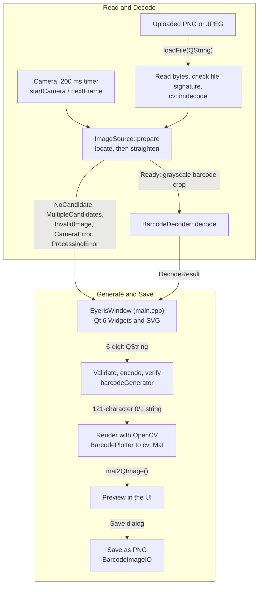
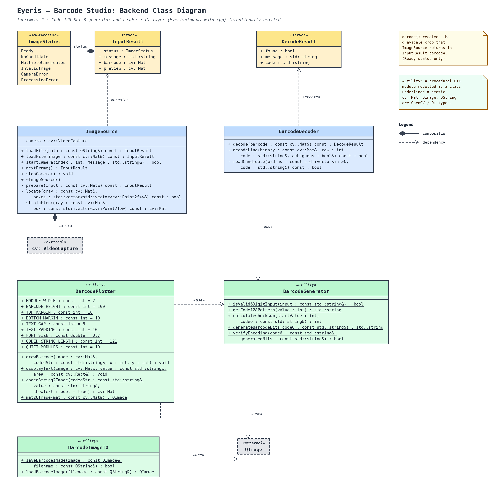

# Eyeris — Barcode Studio

**Increment 1 of the Super Store Inventory and Sales Application (ISE course project)**

Eyeris is a desktop application, written in C++17, that **generates** and **reads** 6-digit **Code 128 (Set B)** barcodes. It is the first increment of a retail point-of-sale (POS) system built for the *Introduction to Software Engineering* (ISE) course.

The Code 128 encoder and decoder are **written by the team from scratch**. No external barcode-generation or barcode-reading library is used. Qt provides the user interface, and OpenCV provides image rendering, loading, camera capture and image processing.

---

## Table of Contents

1. [Features](#features)
2. [Requirements Covered](#requirements-covered)
3. [Tech Stack](#tech-stack)
4. [Building and Running](#building-and-running)
5. [Using the Application](#using-the-application)
6. [How It Works](#how-it-works)
7. [Repository Structure](#repository-structure)
8. [Module Reference](#module-reference)
9. [Error Handling](#error-handling)
10. [Testing](#testing)
11. [Known Limitations](#known-limitations)
12. [Design Decisions](#design-decisions)
13. [Team](#team)
14. [Documentation](#documentation)

---

## Features

- **Generate** a Code 128 Set B barcode from a 6-digit number, preview it on screen, and **save it to disk as a PNG** with the human-readable number printed below the bars.
- **Upload** a PNG, JPG or JPEG image, automatically locate and straighten the barcode, and decode it back to the 6-digit number.
- **Scan with a camera** using a live webcam preview. The app detects and straightens a barcode in the frame, then stops scanning and shows the decoded number as soon as a valid reading is found.
- **Robust decoding:** reads upside-down (180°-rotated) barcodes and verifies every reading with a Mod-103 checksum.
- **Honest failure reporting:** if a barcode cannot be read reliably, the app says so. It never guesses or invents digits.

## Requirements Covered

| # | Requirement | Where it is implemented |
|---|---|---|
| R1 | Generate a barcode from a **6-digit number** whose first digit is **non-zero** (`100000`–`999999`) | `barcodeGenerator.cpp` (`isValid6DigitInput`, `generateBarcodeBits`) and the input field in `main.cpp` |
| R2 | Display the barcode on screen and **save it to disk as an image** | `BarcodePlotter.cpp`, `BarcodeImageIO.cpp`, Generate page in `main.cpp` |
| R3 | **Read** a barcode generated in R1 and show the 6-digit number | `BarcodeDecoder.cpp` and the Found page in `main.cpp` |
| R4 | Read from an **uploaded image** or **scan through the laptop camera** | `camera-harness.cpp` (`ImageSource`), Upload and Camera pages in `main.cpp` |
| R5 | **No external non-standard libraries to generate barcodes** | Encoder and decoder are team-written; only Qt and OpenCV are used for GUI, image processing and file handling |

## Tech Stack

| Area | Technology |
|---|---|
| Language | C++17 |
| GUI | Qt 6 (`Widgets`, `Svg`) |
| Image processing, file decoding and camera | OpenCV 4 (`core`, `imgproc`, `imgcodecs`, `videoio`) |
| Build system | CMake 3.16 or newer |

---

## Building and Running

### Prerequisites

- A C++17 compiler (Clang, GCC or MSVC)
- **CMake** 3.16 or newer
- **Qt 6** with the `Widgets` and `Svg` modules
- **OpenCV 4** with the CMake config files installed
- A webcam, if you want to use camera scanning

> **OpenCV components note:** `CMakeLists.txt` currently asks for the components `core imgproc imgcodecs videoio objdetect`. The code only uses the first four. Standard OpenCV 4 installs include `objdetect`, but if CMake fails to configure because that component is missing, remove `objdetect` from the `find_package(OpenCV ...)` line.

### macOS (the verified build path)

The following commands are the ones the team used. Adjust the paths to match your machine.

```sh
cmake -S . -B build/eyeris-ui \
  -DCMAKE_PREFIX_PATH="$HOME/Qt/6.11.0/macos" \
  -DOpenCV_DIR=/opt/homebrew/opt/opencv@4/lib/cmake/opencv4

cmake --build build/eyeris-ui --parallel 4

./build/eyeris-ui/Eyeris.app/Contents/MacOS/Eyeris
```

- `CMAKE_PREFIX_PATH` should point to your Qt 6 kit (the folder that contains `lib/cmake/Qt6`).
- `OpenCV_DIR` should point to the folder that contains `OpenCVConfig.cmake` (here, the Homebrew `opencv@4` install).
- On macOS the build produces an app bundle. A generated `Info.plist` includes the camera usage description (*"Eyeris uses the camera to scan barcodes."*), so macOS will ask for webcam permission the first time you start camera scanning.

### Windows and Linux

The same CMake project is used. Point CMake at your local Qt 6 kit and OpenCV 4 install, then run the `Eyeris` executable from the build directory.

```sh
cmake -S . -B build \
  -DCMAKE_PREFIX_PATH="<path-to-your-Qt6-kit>" \
  -DOpenCV_DIR="<path-to-folder-containing-OpenCVConfig.cmake>"

cmake --build build --parallel 4
```

- The Qt 6 kit must include `Qt6Svg`.
- The `assets/` folder is copied next to the executable after each build. Run the app from the build output so it can find its artwork and icons.

> **Verification status:** The macOS build and run is the path the team has used for development and demo. Builds on Windows and Linux follow the same CMake configuration but have not been verified by the team yet, so treat those instructions as untested.

### Where the app looks for assets

At startup the app searches for `assets/` in this order:

1. `<executable directory>/assets/`
2. `<executable directory>/../Resources/assets/` (macOS app bundle)
3. The source `assets/` folder recorded at compile time

---

## Using the Application

The window is a fixed size (1163 × 574) with a brand panel on the left and a stacked set of pages on the right.

### Home

Two option cards: **Generate a barcode** and **Scan a barcode**.

### Generate a barcode

1. Type a 6-digit number. The field accepts digits only (up to 6) and the first digit must be 1–9.
2. Press **Enter** or click the arrow button.
3. The barcode is rendered with the number printed beneath it. The preview is drawn with nearest-neighbor scaling so the bars stay crisp.
4. Click **Save to disk**. The default file name is `barcode-<digits>.png`. The `.png` extension is added automatically, and you are asked to confirm before overwriting an existing file.

### Scan a barcode

Choose how to provide the barcode:

- **Upload an Image:** pick a `.png`, `.jpg` or `.jpeg` file. The app locates the barcode, straightens it and decodes it.
- **Use a Camera:** click **Start Camera** to open the default camera (device index `0`). The app checks a new frame every 200 ms. When a barcode is found and decoded, scanning stops automatically. Click **Stop Camera** to cancel.

On success the **Found** page shows the decoded 6-digit number, with a **Scan another** button to start again.

**Tips for a good scan**

- Keep the whole barcode in view, including the blank white margins on its left and right.
- Use even lighting and avoid glare or shadows across the bars.
- Show only **one** barcode at a time.
- Hold the barcode steady and large enough in the frame for the bars to be distinguishable.

---

## How It Works

### Pipeline



### Encoding (Code 128 Set B)

Each barcode is built as a string of **121 bits**:

| Part | Bits |
|---|---|
| Left quiet zone (white) | 10 |
| Start B | 11 |
| 6 data digits (11 bits each) | 66 |
| Checksum symbol | 11 |
| Stop | 13 |
| Right quiet zone (white) | 10 |
| **Total** | **121** |

- A lookup table holds all 107 Code 128 symbol patterns (values 0–106).
- Digits `'0'`–`'9'` map to Set B symbol values 16–25 (ASCII value minus 32).
- The checksum is `(startValue + Σ(symbolValue × position)) mod 103`, where Start B has value 104 and positions count from 1. For `123456` the checksum is **16**.
- After generating the bits, the encoder verifies its own output: length, quiet zones, Start B, each digit, the checksum and the stop pattern.

### Rendering

- Each bit is drawn two pixels wide (`MODULE_WIDTH = 2`), so the barcode image is **242 px wide**, with 100 px tall bars.
- The 6-digit number is printed centered beneath the bars.
- Rendering uses OpenCV (`cv::Mat`). A small adapter (`mat2QImage`) converts the result to a `QImage` for display and saving as a **lossless PNG**.

### Locating and straightening a barcode (`ImageSource`)

Candidate detection uses **pure OpenCV image processing**. It does not use OpenCV's built-in barcode detector.

1. The image is shrunk (longest side at most 640 px) for fast analysis.
2. Sobel gradients and a smoothed **structure tensor** highlight regions with strong, consistently oriented edges, which is what parallel barcode bars look like.
3. Morphological closing joins those regions into blobs, and contours are extracted.
4. Blobs are filtered by size, aspect ratio, fill ratio and directional coherence, and their dominant bar angle is estimated.
5. A final check confirms the region really contains alternating black and white bars (typically 22–110 transitions across several scanlines).
6. The result is **0 candidates** (`NoCandidate`), **more than 1** (`MultipleCandidates`), or **exactly 1**. A single candidate is straightened with a perspective warp, keeping the real white margins on both sides without inventing artificial ones.

### Decoding (`BarcodeDecoder`)

1. Convert to a binary image with **Otsu thresholding**.
2. Sample up to **31 evenly spaced rows** across the barcode.
3. Convert each row into **run lengths** (alternating white and black pixel widths).
4. Slide a 57-run window across the row. It covers quiet zone, Start B, six digits, checksum, Stop and the closing quiet zone.
5. Estimate the module width, check the quiet zones, and match each group of runs against the symbol table using a normalized error score. Ambiguous matches (the best match not clearly better than the second best) are rejected.
6. Decode the six digits, check the first digit is non-zero, then **independently decode the printed checksum symbol** and require it to match the checksum computed from the digits.
7. Repeat on the horizontally flipped image so upside-down barcodes also decode.
8. If different rows or directions give conflicting valid readings, the decoder rejects the result and asks the user to try again.

---

## Repository Structure

All C++ sources sit at the repository root.

```text
ISE-Project/
├── CMakeLists.txt             # Build configuration for the "Eyeris" target
├── README.md                  # This file
├── .gitignore
├── ReaderContracts.h          # Shared types: ImageStatus, InputResult, DecodeResult
├── main.cpp                   # Qt 6 GUI (EyerisWindow) and application orchestration
├── barcodeGenerator.h / .cpp  # Input validation, Code 128 Set B encoder, checksum, verification
├── BarcodePlotter.h / .cpp    # OpenCV barcode renderer and cv::Mat to QImage adapter
├── BarcodeImageIO.h / .cpp    # PNG saving (and an image-loading helper)
├── camera-harness.h / .cpp    # ImageSource: file loading, camera capture, locate and straighten
├── BarcodeDecoder.h / .cpp    # Custom Code 128 Set B decoder
├── assets/
│   ├── eyeris-background.png  # Brand panel artwork
│   ├── arrow-right.svg        # Generate submit icon
│   └── chevron-left.svg       # Back button icon
└── documentation/
    ├── Decisions.md           # Project decision log
    ├── increment1_meetingnotes.md  # Meeting notes and action items
    ├── usecase_diagram.png    # Use case diagram
    ├── backend-class-diagram.png  # UML class diagram of the backend classes
    └── backend-class-diagram.svg  # Same diagram as scalable SVG
```

---

## Module Reference

The diagram below shows the backend classes and how they relate. The user interface (`main.cpp`) is not included. Click the image to open it full size.

[](documentation/UML-diagram.png)

The sections below describe each module in detail.

### Shared contracts (`ReaderContracts.h`)

```cpp
enum class ImageStatus {
    Ready, NoCandidate, MultipleCandidates,
    InvalidImage, CameraError, ProcessingError
};

struct InputResult {
    ImageStatus status;
    std::string message;
    cv::Mat barcode;   // On Ready: grayscale (CV_8UC1) crop of the single barcode
    cv::Mat preview;   // Camera frames only: BGR frame for the live preview
};

struct DecodeResult {
    bool found;
    std::string message;
    std::string code;  // The decoded 6-digit number when found
};
```

### `barcodeGenerator` — encoder

| Function | Purpose |
|---|---|
| `isValid6DigitInput(code)` | Exactly 6 characters, all digits, first digit `1`–`9` |
| `getCode128Pattern(value)` | Looks up the bit pattern for symbol values 0–106 |
| `calculateChecksum(startValue, code6)` | Mod-103 checksum |
| `generateBarcodeBits(code6)` | Builds the 121-bit string |
| `verifyEncoding(code6, bits)` | Checks the generated bits segment by segment |

### `BarcodePlotter` and `BarcodeImageIO` — image output

| Function | Purpose |
|---|---|
| `codedString2Image(bits, value, showText)` | Validates the bit string and draws the barcode as a BGR `cv::Mat` |
| `mat2QImage(mat)` | Converts a BGR `cv::Mat` to a deep-copied `QImage` |
| `saveBarcodeImage(image, path)` | Saves a `QImage` as PNG |

### `ImageSource` (`camera-harness`) — input

| Function | Purpose |
|---|---|
| `loadFile(const QString& path)` | Reads a PNG or JPEG file (checks its signature), decodes it, then prepares it |
| `loadFile(const cv::Mat& image)` | Prepares an already-loaded image (1, 3 or 4 channels) |
| `startCamera(index, message)` | Opens the camera, releasing any previous capture |
| `nextFrame()` | Reads one frame and returns the prepared result plus a preview |
| `stopCamera()` | Releases the camera (safe to call repeatedly) |

### `BarcodeDecoder` — output

| Function | Purpose |
|---|---|
| `decode(const cv::Mat& barcode)` | Decodes a grayscale barcode crop into a `DecodeResult` |

The decoder requires at least **121 pixels** of width (one pixel per module).

---

## Error Handling

The application reports clear messages instead of failing silently:

| Situation | Behavior |
|---|---|
| Empty, too short, too long, non-digit or leading-zero input | Rejected before generation |
| File is not a readable PNG/JPEG image | `InvalidImage` error message |
| No barcode found in the image | `NoCandidate` |
| More than one barcode in view | `MultipleCandidates`, with a prompt to scan one at a time |
| Barcode found but unreadable or failing the checksum | Decode failure message and a prompt to try again |
| Camera cannot be opened or read | `CameraError`, and scanning stops |
| Processing problem | `ProcessingError`, and scanning stops |
| Saving the PNG fails | Error message shown |

While the camera is running, `NoCandidate`, `MultipleCandidates` and decode retries are shown as non-blocking status messages, and scanning continues. Scanning stops automatically on a successful decode or on a camera or processing error.

---

## Testing

The team's acceptance checklist for Increment 1 covers the following scenarios. Record your own results as you run them.

**End to end** (generate → display → save PNG → upload PNG → decode, and camera scan) for `100000`, `123456` and `999999`.

**Input validation:** reject empty input, `012345` (leading zero), `12345` (too short), `1234567` (too long) and `123A56` (non-digit).

**Failure handling:** corrupt or non-image files, no barcode in the image, two barcodes in one frame (including two identical ones), a tampered checksum, an unavailable camera, a save failure, and tilted, glared or blurred images (these should fail cleanly, without made-up digits).

> The repository does not yet include recorded results for this matrix or an automated test suite. Results should be added here once the team has run them.

---

## Known Limitations

- **Scope:** only **6-digit Code 128 Set B** barcodes with a non-zero first digit (`100000`–`999999`). Other lengths, symbologies and character sets are not supported.
- **Quiet zones matter:** the decoder needs clear white margins on both sides of the barcode. Tightly cropped images can fail to decode.
- **One barcode at a time:** images or frames with several barcodes are rejected on purpose.
- **Small generated barcodes:** a generated PNG is 242 px wide, which suits direct upload but can be small for a low-resolution webcam to read from a screen or print at a distance.
- **Lighting sensitivity:** the decoder uses a single global (Otsu) threshold. Strong glare, shadows or uneven lighting across the bars can break decoding.
- **Low-resolution or blurred codes:** very small (under about 80 × 12 px) or heavily blurred barcodes are reported as not found or not readable by design.
- **Camera selection:** the app always uses camera index `0`, with no camera picker.
- **Responsiveness:** decoding and frame processing run on the GUI thread every 200 ms during scanning, which can cause brief stutters on slow hardware or very large images.
- **Fixed window size** (1163 × 574), with fonts tuned for macOS.
- **Platform verification:** builds are verified on macOS only (see [Building and Running](#building-and-running)).

---

## Design Decisions

| Decision | Outcome |
|---|---|
| Barcode symbology | **Code 128** over EAN-13, chosen by team vote. It is less complex and only 6 digits are needed. |
| Barcode libraries | **None.** After confirming with the instructor that encoding and decoding must be done manually, ZXing-cpp was dropped and the team wrote its own encoder and decoder. |
| Image processing | **OpenCV**, for rendering, file decoding, camera capture and barcode localization. |
| GUI | **Qt 6**, used only for the front end. |
| Qt/OpenCV bridge | A small adapter converts `cv::Mat` images to `QImage` for display and saving. |

The full history is in [`documentation/Decisions.md`](documentation/Decisions.md) and [`documentation/increment1_meetingnotes.md`](documentation/increment1_meetingnotes.md).

---

## Team

| Member | Area | Main files |
|---|---|---|
| **Zaryab** | Desktop interface, build setup and integration | `main.cpp`, `CMakeLists.txt`, `assets/` |
| **Nosher** | Barcode generation logic (Code 128 Set B encoder) | `barcodeGenerator.h/.cpp` |
| **Khurram** | Barcode image rendering and PNG saving | `BarcodePlotter.h/.cpp`, `BarcodeImageIO.h/.cpp` |
| **Rayyan** | Camera capture, barcode localization and straightening | `camera-harness.h/.cpp` |
| **Rayan** | Barcode decoding | `BarcodeDecoder.h/.cpp` |

## Documentation

- [`documentation/Decisions.md`](documentation/Decisions.md): project decision log
- [`documentation/increment1_meetingnotes.md`](documentation/increment1_meetingnotes.md): meeting notes and action items
- [`documentation/backend-class-diagram.png`](documentation/backend-class-diagram.png): UML class diagram of the backend classes
- [`documentation/usecase_diagram.png`](documentation/usecase_diagram.png): use case diagram (an early Increment 1 version; it may not reflect later changes to ownership and libraries)

---

*Later increments build on this barcode generator and reader for the full store inventory and sales system.*
